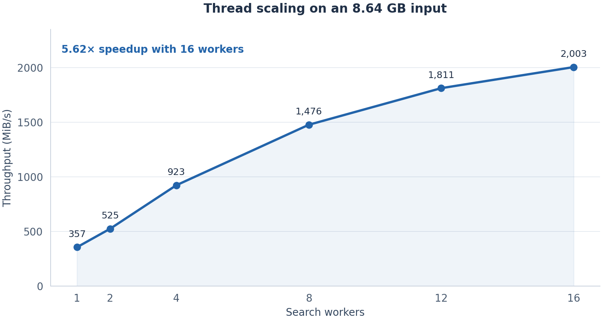
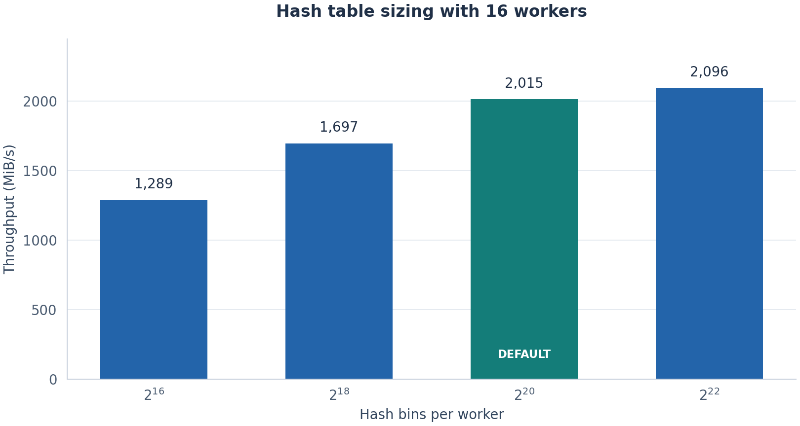
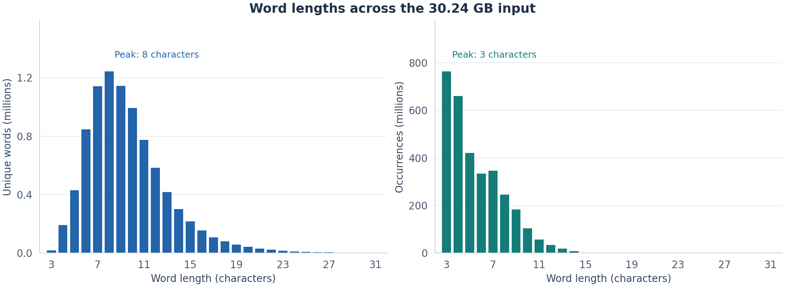
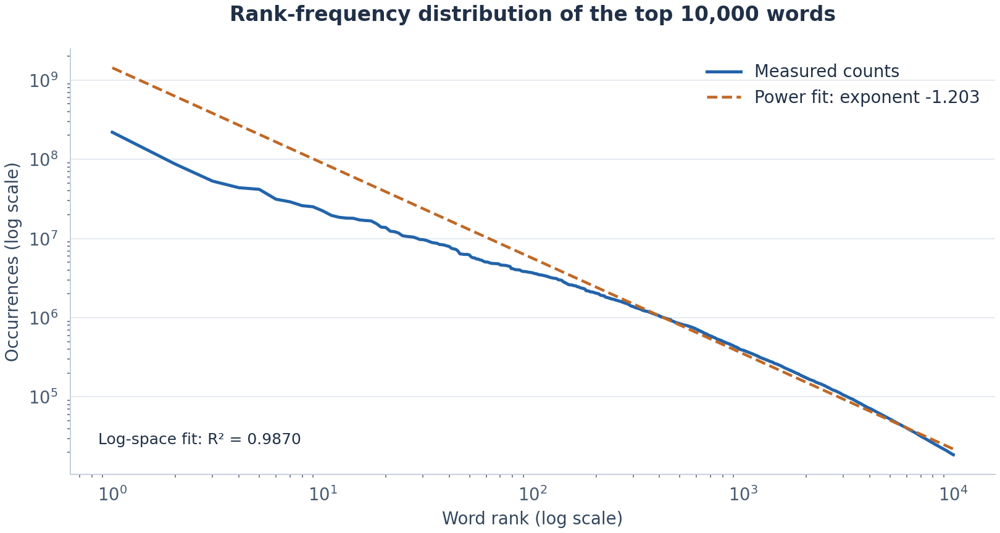

# Parallel Wikipedia Indexer

A C++ word counter for large Wikipedia text files. A disk reader feeds Win32 worker threads through a bounded queue, and each worker builds a custom hash table. The benchmarks track how tokenization, memory layout, and synchronization affect throughput across inputs ranging from megabytes to tens of gigabytes.

On an 8.64 GB input, 16 workers reached 2,003 MiB/s, a 5.62× speedup over one worker. A separate 30.24 GB run processed 4.53 billion candidate words and counted 8.86 million unique eligible words.

## Architecture


| Component | Design and purpose |
| --- | --- |
| Disk reader | Reads sequentially and carries a small shadow region between buffers to handle words at chunk boundaries. |
| Work queue | A 24-slot ring buffer uses semaphores and a critical section to coordinate the producer and consumers. |
| Search workers | Each worker tokenizes its buffers and updates a private hash table without a shared table lock. |
| Hash tables | Chained hash bins point into packed records. Each table reserves 2 GiB of virtual address space and commits memory in 1 MiB increments as needed. |
| Final merge | Combines the workers' tables after they finish to obtain the final unique-word count. |
| Statistics thread | Reports progress, throughput, word counts, hash lookup depth, CPU utilization, and working-set memory every two seconds. |

Tokenization uses byte lookup tables for ASCII letter detection, lowercase conversion, delimiters, and hashing. Eligible words contain 3 to 31 letters and must meet the delimiter rules. The program counts words in the supplied text without stripping Wikipedia markup or processing Unicode languages.

## Build and run

### Requirements

- Windows x64.
- Visual Studio 2022 with Desktop development with C++, the MSVC v143 toolset, and a Windows SDK.
- Enough memory for the per-worker tables; memory use grows with the worker count and vocabulary size.

Run these commands in Developer PowerShell for VS 2022:

```powershell
git clone https://github.com/andrewv426/parallel-wikipedia-indexer.git
cd parallel-wikipedia-indexer
msbuild wordIndexer.sln /m /p:Configuration=Release /p:Platform=x64
.\x64\Release\wordIndexer.exe 20 .\enwiki-all.txt
```

You can also open `wordIndexer.sln`, select Release | x64, and build in Visual Studio. Supply your own plain-text input file; the repository excludes the large Wikipedia datasets.

```text
wordIndexer <log2_buf_size> <input_file>
```

The first argument sets the buffer size to `2^log2_buf_size` bytes: `20` means 1 MiB. Quote input paths that contain spaces. The executable chooses the worker count from the logical processor count, capped at 64, and uses `2^20` hash bins per worker. [Config.h](wordIndexer/Config.h) defines the hash size, queue capacity, word-length limits, and statistics interval.

The program prints progress and timing to standard error, and final `Unique`, `Invalid`, and `Total` counts to standard output. Debug builds also run lookup-table assertions at startup.

## Measured performance

Measurements used Windows 11, Visual Studio 2022 / MSVC x64 Release, 1 MiB read buffers, and warm input caches. Dataset runs used 16 workers and `2^20` hash bins per worker. The timer covers thread startup, indexing, and the final merge. The records contain individual runs without the hardware model or variance across repeated runs.

Throughput is in MiB/s (`bytes / 1,048,576 / seconds`), as calculated in the source. Input sizes use decimal MB and GB.

| Input | Size | Time (s) | Throughput (MiB/s) | Unique words |
| --- | ---: | ---: | ---: | ---: |
| Tiny | 52.16 MB | 0.0765 | 650 | 183,733 |
| Small | 536.87 MB | 0.5139 | 996 | 757,198 |
| Medium | 8.64 GB | 4.1547 | 1,982 | 4,871,639 |
| Large | 30.24 GB | 27.1293 | 1,063 | 8,861,171 |

### Thread scaling

On the medium input, throughput rose from 357 MiB/s with one worker to 2,003 MiB/s with 16 workers. The pipeline shares the reader, queue, and memory bandwidth, then performs a final merge, so the speedup is sublinear.



| Workers | 1 | 2 | 4 | 8 | 12 | 16 |
| --- | ---: | ---: | ---: | ---: | ---: | ---: |
| MiB/s | 357 | 525 | 923 | 1,476 | 1,811 | 2,003 |
| Speedup | 1.00× | 1.47× | 2.59× | 4.14× | 5.08× | 5.62× |

### Hash table sizing

With 16 workers, increasing the bin count from `2^16` to `2^20` raised throughput from 1,289 to 2,015 MiB/s. The `2^22` run reached 2,096 MiB/s, about 4% higher, while using four times the bin-array memory per worker. The default `2^20` setting uses 4 MiB per bin array, compared with 16 MiB at `2^22`; record storage is additional.



## Word distributions

On the large input, 8-character words make up the largest group of distinct words. Words with 3 characters occur most often: a small set of common short words accounts for many occurrences, while longer words contribute more distinct entries to the vocabulary.



A least-squares fit in log space for the top 10,000 words gives `frequency ∝ rank^-1.203`, with `R² = 0.9870`. The rank-frequency relationship is strong overall, though the most frequent words visibly depart from the fitted line.



## Benchmark data and figures

The figures use the original CSV measurements in [benchmarks/data](benchmarks/data). The thread/hash sweeps and word-distribution exports come from a parameterized benchmark build. The current CLI accepts only the buffer size and input path.

To regenerate the figures with Python, NumPy, and Matplotlib:

```powershell
python -m pip install numpy matplotlib
python benchmarks/plot_results.py
```

[plot_results.py](benchmarks/plot_results.py) reads the saved measurements and writes four PNG figures. The summary CSV has the exact byte counts, timings, thread counts, and hash settings used in the rounded tables.

## Source map

| Path | Contents |
| --- | --- |
| [wordIndexer/](wordIndexer) | Tokenizer, hash table, disk reader, queue, workers, statistics, and CLI. |
| [mt/](mt) | Mersenne Twister utilities used to seed the hashing lookup table. |
| [benchmarks/](benchmarks) | Measured CSV snapshots, plotting script, and README figures. |
| `keywords-A.txt` through `keywords-D.txt` | Keyword fixtures for experimentation. |
